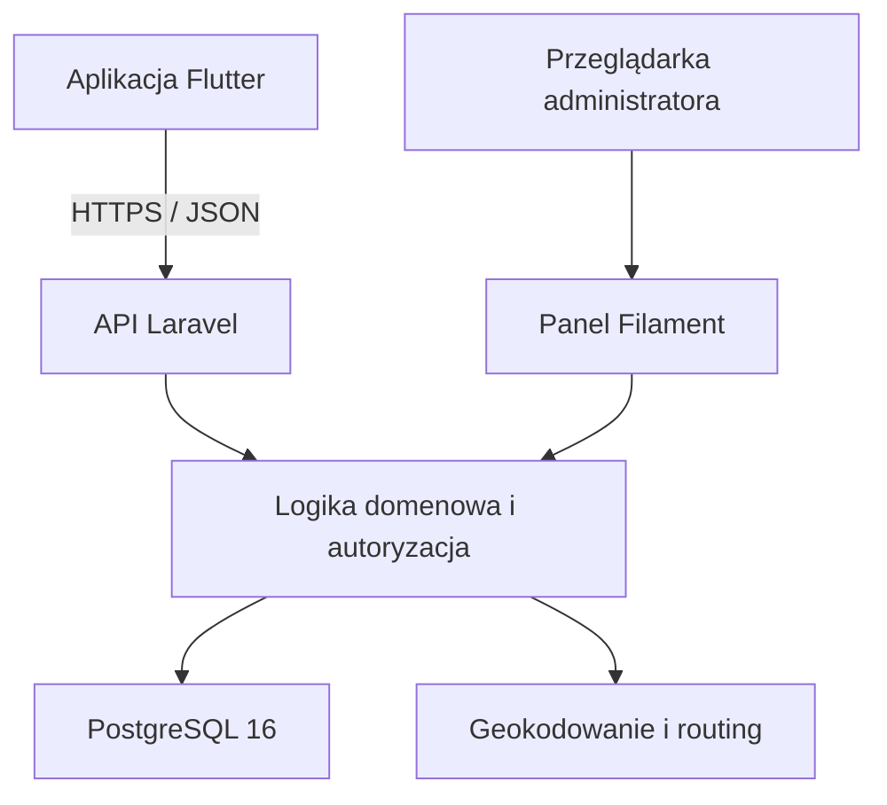

# MilesAway, dziennik podróży
**Projekt aplikacji turystycznej będącej osobistym dziennikiem podróży. Docelowo użytkownik będzie dokumentować odbyte podróże, oglądać je na interaktywnej mapie i przeglądać statystyki z całej historii lub wybranego roku.**

MilesAway to projekt aplikacji turystycznej umożliwiającej dokumentowanie odbytych podróży, prezentowanie tras na interaktywnej mapie oraz przeglądanie statystyk podróżniczych.

Celem aplikacji jest stworzenie miejsca, w którym użytkownik może zobaczyć, gdzie był, jakie państwa odwiedził i jakimi środkami transportu podróżował na przestrzeni lat.

System obejmuje:

- aplikację mobilną napisaną we Flutterze,
- API przygotowane w Laravel,
- webowy panel administracyjny oparty na Filament,
- bazę danych PostgreSQL.

## Cel projektu

MilesAway ma pełnić funkcję osobistego dziennika podróży.

Użytkownik powinien mieć możliwość zapisania podróży składającej się z wielu miejsc i odcinków, określenia transportu dla każdego odcinka oraz późniejszego przeglądania swojej historii na mapie.

Najważniejszym rezultatem projektu jest działająca aplikacja z czytelnym interfejsem, wiarygodną prezentacją tras i statystykami obejmującymi wiele lat podróżowania.

Projekt API i panelu administracyjnego jest powiązany z aplikacją realizowaną w ramach przedmiotu **Programowanie urządzeń mobilnych**.

## Funkcjonalności
### Konta użytkowników

- Rejestracja, logowanie i wylogowywanie.
- Edycja podstawowych danych profilu.
- Ustawianie profilu jako publiczny lub prywatny.
- Przeglądanie podróży innych użytkowników, jeśli ich profile są publiczne.
- Kontrola dostępu do danych po stronie API.

### Zarządzanie podróżami

- Dodawanie, przeglądanie, edytowanie i usuwanie podróży.
- Zapisywanie nazwy, daty lub zakresu dat oraz opcjonalnego opisu.
- Dodawanie wielu punktów do jednej podróży.
- Określanie kolejności odwiedzanych miejsc.
- Wybieranie środka transportu osobno dla każdego odcinka.
- Obsługa powrotów do wcześniej odwiedzonych miejsc.

### Interaktywna mapa

- Wyświetlanie pojedynczej podróży wraz z punktami i odcinkami.
- Wyświetlanie wszystkich podróży użytkownika na jednej mapie.
- Rozróżnianie transportu za pomocą kolorów, ikon lub stylów linii.
- Przybliżanie mapy i przeglądanie szczegółów tras.
- Automatyczne rozpoznawanie odwiedzonych państw na podstawie zapisanych podróży.
- Wyróżnianie odwiedzonych państw z wykorzystaniem danych ich granic.

### Statystyki podróżnicze

Statystyki obejmują **całą historię podróży** lub **wybrany rok kalendarzowy**:

- liczbę odbytych podróży,
- liczbę i listę odwiedzonych państw,
- liczbę odwiedzonych miejsc,
- łączny przebyty dystans,
- dystans pokonany poszczególnymi środkami transportu.

Szczegółowe zasady obliczeń, w tym sposób uwzględniania podróży na przełomie roku i powtarzających się miejsc, wymagają wspólnego zatwierdzenia przez zespół.

### Panel administracyjny

Webowy panel Filament służy do zarządzania danymi aplikacji.

Proponowany zakres obejmuje:

- logowanie administratora,
- przeglądanie i wyszukiwanie użytkowników,
- zarządzanie dozwolonymi danymi użytkowników,
- przeglądanie i zarządzanie podróżami,
- kontrolę dostępu do operacji administracyjnych.

Szczegółowe uprawnienia administratora, w tym dostęp do prywatnych podróży, wymagają zatwierdzenia. Zwykłe konto użytkownika nie przyznaje dostępu do panelu.

## Środki transportu

| Środek transportu | Sposób prezentacji |
| --- | --- |
| Samochód | Trasa wyznaczana po rzeczywistej sieci dróg. |
| Samolot | Bezpośrednie połączenie między punktami przedstawione na mapie jako łuk. |
| Pociąg | Połączenie przedstawione linią prostą. |
| Inne | Uproszczone połączenie między punktami. |

Transport jest przypisywany do **odcinka**, a nie do całej podróży.

Dystans samochodowy powinien pochodzić z silnika wyznaczania tras. Dla pozostałych środków transportu proponowane jest obliczanie odległości geodezyjnej i oznaczanie jej jako przybliżonej.

Brak możliwości wyznaczenia trasy samochodowej powinien być jawnie komunikowany. Linia prosta nie może być przedstawiana jako poprawnie wyznaczona trasa drogowa.

## Przykładowa podróż

| Kolejność | Odcinek | Transport |
| --- | --- | --- |
| 1 | Legnica → Berlin | Samochód |
| 2 | Berlin → Majorka | Samolot |
| 3 | Zwiedzanie Majorki — kilka punktów | Samochód |
| 4 | Majorka → Berlin | Samolot |
| 5 | Berlin → Legnica | Samochód |

Każdy odcinek zachowuje własny środek transportu, geometrię i dystans.

## Stack technologiczny

| Obszar | Technologia | Status |
| --- | --- | --- |
| Backend | PHP 8.3+, Laravel 12 | Wybrane |
| Uwierzytelnianie API | Laravel Sanctum | Wybrane |
| Panel administracyjny | Laravel Filament | Wybrane; wersja do ustalenia |
| Aplikacja mobilna | Flutter + Dart | Wybrane |
| Środowisko mobilne | Android Studio | Wybrane |
| Baza danych | PostgreSQL 16 | Wybrane |
| Konteneryzacja | Docker, Docker Compose | Wybrane |
| Mapa mobilna | Pakiet mapowy kompatybilny z Flutterem | Do ustalenia |
| Wyznaczanie tras | OpenRouteService lub OSRM | Do ustalenia |
| Geokodowanie | Nominatim, Photon lub inny dostawca | Do ustalenia |
| Granice państw | GeoJSON, np. Natural Earth | Zbiór i wersja do ustalenia |
| Testy backendu | PHPUnit | Wybrane |
| Testy mobilne | `flutter_test`, `integration_test` | Propozycja |
| Formatowanie PHP | Laravel Pint | Wybrane |
| Jakość kodu Dart | `dart format`, `flutter analyze` | Propozycja |
| CI/CD | GitHub Actions | Wybrane narzędzie; workflow do przygotowania |

## Architektura

backend/    # Laravel: REST API
mobile/     # Aplikacja mobilna Flutter
docker/     # Konfiguracja środowiska kontenerowego (Nginx, PHP, Node)
docs/       # Dokumentacja projektu

### Aplikacja mobilna

Odpowiada za interfejs użytkownika, formularze, prezentację map i statystyk oraz komunikację z API.

### API Laravel

Odpowiada za:

- uwierzytelnianie i autoryzację,
- walidację danych,
- zarządzanie profilami i podróżami,
- egzekwowanie prywatności,
- integrację z usługami zewnętrznymi,
- obliczanie statystyk.

Proponowany mechanizm uwierzytelniania aplikacji mobilnej to tokeny Laravel Sanctum.

### Panel Filament

Zapewnia webowy interfejs administracyjny. Powinien korzystać ze wspólnych reguł domenowych, aby zmiany administracyjne poprawnie aktualizowały trasy i statystyki.

Proponowany mechanizm logowania do panelu to sesja webowa.

### PostgreSQL

Przechowuje dane użytkowników, podróży, punktów, odcinków oraz informacje potrzebne do prezentowania map i statystyk.

## Interfejs użytkownika

Kierunek wizualny MilesAway to nowoczesny flat design z prostymi ilustracjami i warstwowym krajobrazem **paper cut-out**.

Założenia stylistyczne:

- ciepła paleta beżu, brązu, złota i leśnej zieleni,
- zaokrąglone karty,
- subtelne cienie,
- delikatna faktura,
- czytelne formularze i prosta nawigacja.

Planowane ekrany:

- logowanie i rejestracja,
- ekran główny,
- lista podróży,
- dodawanie i edycja podróży,
- szczegóły podróży z mapą,
- mapa wszystkich podróży,
- statystyki,
- profil i ustawienia prywatności,
- przeglądanie publicznych profili i ich podróży.

Wymagania
Docker Desktop (z obsługą Docker Compose v2)
Git
(Opcjonalnie do pracy bez kontenerów: PHP >= 8.3 i Composer, Node.js 22.18+ (lub 24.12+) i npm, PostgreSQL 16).

Uruchomienie lokalne (Docker)
Sklonuj repozytorium:

git clone <url-repo>
cd dziennik
Skonfiguruj zmienne środowiskowe:

cp .env.example .env
cp .env backend/.env
cp frontend/.env.example frontend/.env
Główny .env dostarcza zmienne dla Docker Compose, a backend/.env jest używany przez Laravel. Oba pliki muszą mieć zgodne wartości DB_*. Ustaw niepuste lokalne DB_PASSWORD w głównym .env przed uruchomieniem bazy.

Zbuduj i uruchom kontenery w tle:

docker compose up -d --build
Zainstaluj zależności backendu:

docker compose exec backend composer install
Zainicjalizuj backend wewnątrz kontenera:

# Sprawdź, czy backend/.env zawiera klucz; wygeneruj go tylko, jeśli jest pusty
docker compose exec backend sh -c 'if grep -q "^APP_KEY=." .env; then echo "APP_KEY jest ustawiony"; else echo "APP_KEY jest pusty — generuję klucz"; php artisan key:generate; fi'

# Odtwórz backend, aby kontener wczytał APP_KEY z pliku backend/.env
docker compose up -d --force-recreate backend

# Sprawdź, czy klucz jest dostępny w środowisku kontenera (bez wypisywania wartości)
docker compose exec backend php -r "echo getenv('APP_KEY') ? 'APP_KEY jest ustawiony' : 'APP_KEY jest pusty';"

# Wykonanie migracji bazy i seedera
docker compose exec backend php artisan migrate --seed
Dostęp do aplikacji
Frontend (Vue/Vite): http://localhost:5173 (z hot-reloadem Vite)
Backend (API / Nginx): http://localhost:8000
Baza danych (PostgreSQL): localhost:5432 (baza, użytkownik i hasło zgodne z głównym .env)
Przydatne polecenia Docker
# Zatrzymanie kontenerów
docker compose down

# Podgląd logów wszystkich usług
docker compose logs -f

# Wejście do powłoki kontenera backendu
docker compose exec backend sh

# Uruchamianie komend Artisan
docker compose exec backend php artisan <komenda>
Konfiguracja
Zmienne środowiskowe ustawiasz w plikach .env (nie commituj ich do repozytorium). Wartości w głównym .env i backend/.env muszą być zgodne. Lokalnego hasła do bazy nie używaj na środowisku produkcyjnym.

W pliku backend/.env dla środowiska Docker hostem bazy danych jest nazwa kontenera postgres:

DB_CONNECTION=pgsql
DB_HOST=postgres
DB_PORT=5432
DB_DATABASE=dziennik
DB_USERNAME=dziennik_user
DB_PASSWORD=local_dev_password
Zmienna	Opis
DB_*	Dane połączenia z bazą (backend)
ROUTING_API_KEY	Klucz do API wyznaczania tras (do skonfigurowania, gdy funkcja zostanie wdrożona)
GEOCODING_API_KEY	Klucz do API geokodowania (do skonfigurowania, gdy funkcja zostanie wdrożona)
VITE_API_BASE_URL	Bazowy adres API frontendu (domyślnie http://localhost:8000/api/v1)
Testy i jakość kodu
Polecenia lokalne uruchamiamy w kontenerach:

# Backend
docker compose exec backend php artisan test
docker compose exec backend ./vendor/bin/pint --test

# Frontend
docker compose exec frontend npm run lint
docker compose exec frontend npm run test
docker compose exec frontend npm run build
GitHub Actions uruchamia testy backendu i build frontendu dla PR. Zmiany w frontend/ uruchamiają dodatkowo workflow lint/test/build frontendu; osobny workflow sprawdza formatowanie backendu. Mimo to przed wysłaniem PR uruchom lokalnie wszystkie kontrole z powyższej listy.

Współpraca
Zasady współpracy opisuje CONTRIBUTING.md, procedura realizacji zadań jest w TASK_ins.md, a backlog w TASK.md.

Licencja
Projekt udostępniany na licencji MIT. Szczegóły w pliku LICENSE.
