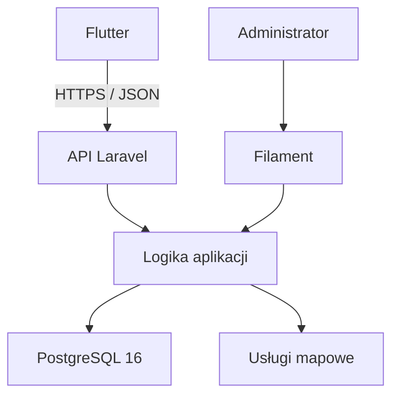

# MilesAway, dziennik podróży
**Projekt aplikacji turystycznej będącej osobistym dziennikiem podróży. Docelowo użytkownik będzie dokumentować odbyte podróże, oglądać je na interaktywnej mapie i przeglądać statystyki z całej historii lub wybranego roku.**

MilesAway to projekt aplikacji turystycznej umożliwiającej dokumentowanie odbytych podróży, prezentowanie tras na interaktywnej mapie oraz przeglądanie statystyk podróżniczych.

Celem aplikacji jest stworzenie miejsca, w którym użytkownik może zobaczyć, gdzie był, jakie państwa odwiedził i jakimi środkami transportu podróżował na przestrzeni lat.

System obejmuje:

- aplikację mobilną napisaną we Flutterze,
- API przygotowane w Laravel,
- webowy panel administracyjny oparty na Filament,
- bazę danych PostgreSQL.

## Cel projektu

MilesAway ma pełnić funkcję osobistego dziennika podróży.

Użytkownik powinien mieć możliwość zapisania podróży składającej się z wielu miejsc i odcinków, określenia transportu dla każdego odcinka oraz późniejszego przeglądania swojej historii na mapie.

Najważniejszym rezultatem projektu jest działająca aplikacja z czytelnym interfejsem, wiarygodną prezentacją tras i statystykami obejmującymi wiele lat podróżowania.

Projekt API i panelu administracyjnego jest powiązany z aplikacją realizowaną w ramach przedmiotu **Programowanie urządzeń mobilnych**.

## Funkcjonalności
### Konta użytkowników

- Rejestracja, logowanie i wylogowywanie.
- Edycja podstawowych danych profilu.
- Ustawianie profilu jako publiczny lub prywatny.
- Przeglądanie podróży innych użytkowników, jeśli ich profile są publiczne.
- Kontrola dostępu do danych po stronie API.

### Zarządzanie podróżami

- Dodawanie, przeglądanie, edytowanie i usuwanie podróży.
- Zapisywanie nazwy, daty lub zakresu dat oraz opcjonalnego opisu.
- Dodawanie wielu punktów do jednej podróży.
- Określanie kolejności odwiedzanych miejsc.
- Wybieranie środka transportu osobno dla każdego odcinka.
- Obsługa powrotów do wcześniej odwiedzonych miejsc.

### Interaktywna mapa

- Wyświetlanie pojedynczej podróży wraz z punktami i odcinkami.
- Wyświetlanie wszystkich podróży użytkownika na jednej mapie.
- Rozróżnianie transportu za pomocą kolorów, ikon lub stylów linii.
- Przybliżanie mapy i przeglądanie szczegółów tras.
- Automatyczne rozpoznawanie odwiedzonych państw na podstawie zapisanych podróży.
- Wyróżnianie odwiedzonych państw z wykorzystaniem danych ich granic.

### Statystyki podróżnicze

Statystyki obejmują **całą historię podróży** lub **wybrany rok kalendarzowy**:

- liczbę odbytych podróży,
- liczbę i listę odwiedzonych państw,
- liczbę odwiedzonych miejsc,
- łączny przebyty dystans,
- dystans pokonany poszczególnymi środkami transportu.

Szczegółowe zasady obliczeń, w tym sposób uwzględniania podróży na przełomie roku i powtarzających się miejsc, wymagają wspólnego zatwierdzenia przez zespół.

### Panel administracyjny

Webowy panel Filament służy do zarządzania danymi aplikacji.

Proponowany zakres obejmuje:

- logowanie administratora,
- przeglądanie i wyszukiwanie użytkowników,
- zarządzanie dozwolonymi danymi użytkowników,
- przeglądanie i zarządzanie podróżami,
- kontrolę dostępu do operacji administracyjnych.

Szczegółowe uprawnienia administratora, w tym dostęp do prywatnych podróży, wymagają zatwierdzenia. Zwykłe konto użytkownika nie przyznaje dostępu do panelu.

## Środki transportu

| Środek transportu | Sposób prezentacji |
| --- | --- |
| Samochód | Trasa wyznaczana po rzeczywistej sieci dróg. |
| Samolot | Bezpośrednie połączenie między punktami przedstawione na mapie jako łuk. |
| Pociąg | Połączenie przedstawione linią prostą. |
| Inne | Uproszczone połączenie między punktami. |

Transport jest przypisywany do **odcinka**, a nie do całej podróży.

Dystans samochodowy powinien pochodzić z silnika wyznaczania tras. Dla pozostałych środków transportu proponowane jest obliczanie odległości geodezyjnej i oznaczanie jej jako przybliżonej.

Brak możliwości wyznaczenia trasy samochodowej powinien być jawnie komunikowany. Linia prosta nie może być przedstawiana jako poprawnie wyznaczona trasa drogowa.

## Przykładowa podróż

| Kolejność | Odcinek | Transport |
| --- | --- | --- |
| 1 | Legnica → Berlin | Samochód |
| 2 | Berlin → Majorka | Samolot |
| 3 | Zwiedzanie Majorki — kilka punktów | Samochód |
| 4 | Majorka → Berlin | Samolot |
| 5 | Berlin → Legnica | Samochód |

Każdy odcinek zachowuje własny środek transportu, geometrię i dystans.

## Stack technologiczny

| Obszar | Technologia | Status |
| --- | --- | --- |
| Backend | PHP 8.3+, Laravel 12 | Wybrane |
| Uwierzytelnianie API | Laravel Sanctum | Wybrane |
| Panel administracyjny | Laravel Filament | Wybrane; wersja do ustalenia |
| Aplikacja mobilna | Flutter + Dart | Wybrane |
| Środowisko mobilne | Android Studio | Wybrane |
| Baza danych | PostgreSQL 16 | Wybrane |
| Konteneryzacja | Docker, Docker Compose | Wybrane |
| Mapa mobilna | Pakiet mapowy kompatybilny z Flutterem | Do ustalenia |
| Wyznaczanie tras | OpenRouteService lub OSRM | Do ustalenia |
| Geokodowanie | Nominatim, Photon lub inny dostawca | Do ustalenia |
| Granice państw | GeoJSON, np. Natural Earth | Zbiór i wersja do ustalenia |
| Testy backendu | PHPUnit | Wybrane |
| Testy mobilne | `flutter_test`, `integration_test` | Propozycja |
| Formatowanie PHP | Laravel Pint | Wybrane |
| Jakość kodu Dart | `dart format`, `flutter analyze` | Propozycja |
| CI/CD | GitHub Actions | Wybrane narzędzie; workflow do przygotowania |

## Architektura



Usługi mapowe obejmują geokodowanie i wyznaczanie tras.

## Struktura projektu

```text
backend/  # Laravel: REST API i panel Filament
mobile/   # Aplikacja mobilna Flutter
docker/   # Konfiguracja środowiska kontenerowego
docs/     # Dokumentacja projektu
```

### Aplikacja mobilna

Odpowiada za interfejs użytkownika, formularze, prezentację map i statystyk oraz komunikację z API.

### API Laravel

Odpowiada za:

- uwierzytelnianie i autoryzację,
- walidację danych,
- zarządzanie profilami i podróżami,
- egzekwowanie prywatności,
- integrację z usługami zewnętrznymi,
- obliczanie statystyk.

Proponowany mechanizm uwierzytelniania aplikacji mobilnej to tokeny Laravel Sanctum.

### Panel Filament

Zapewnia webowy interfejs administracyjny. Powinien korzystać ze wspólnych reguł domenowych, aby zmiany administracyjne poprawnie aktualizowały trasy i statystyki.

Proponowany mechanizm logowania do panelu to sesja webowa.

### PostgreSQL

Przechowuje dane użytkowników, podróży, punktów, odcinków oraz informacje potrzebne do prezentowania map i statystyk.

## Interfejs użytkownika

Kierunek wizualny MilesAway to nowoczesny flat design z prostymi ilustracjami i warstwowym krajobrazem **paper cut-out**.

Założenia stylistyczne:

- ciepła paleta beżu, brązu, złota i leśnej zieleni,
- zaokrąglone karty,
- subtelne cienie,
- delikatna faktura,
- czytelne formularze i prosta nawigacja.

Planowane ekrany:

- logowanie i rejestracja,
- ekran główny,
- lista podróży,
- dodawanie i edycja podróży,
- szczegóły podróży z mapą,
- mapa wszystkich podróży,
- statystyki,
- profil i ustawienia prywatności,
- przeglądanie publicznych profili i ich podróży.

## Podgląd interfejsu

Projekt interfejsu MilesAway przygotowany w Figmie.
Przedstawione ekrany są makietami i mogą różnić się od aktualnej implementacji.
[Zobacz projekt w Figmie](https://www.figma.com/proto/nSX2TDl5FtEVm8SDGntw0F/Untitled?node-id=1-3&t=BXHsufh2riFxy2p7-1&scaling=contain&content-scaling=responsive&page-id=0%3A1&starting-point-node-id=1%3A3)

## Wymagania

### Backend i panel administracyjny

- [Docker Desktop](https://www.docker.com/products/docker-desktop/) z Docker Compose v2 — Windows/macOS.
- Docker Engine i Docker Compose v2 — Linux lub serwer VPS.
- Git.

Do uruchomienia backendu bez kontenerów potrzebne są również:

- PHP 8.3+ z rozszerzeniami wymaganymi przez projekt,
- Composer,
- PostgreSQL 16,
- Node.js i npm, jeżeli projekt wymaga budowania zasobów panelu.

Wersje zależności należy dopasować do plików `composer.json` i `package.json`.

### Aplikacja mobilna

- Flutter SDK wraz z Dart — wersja zgodna z projektem.
- Android Studio z Android SDK.
- Emulator Android lub urządzenie z włączonym debugowaniem USB.

Aplikację mobilną uruchamiamy przez Flutter na komputerze deweloperskim. Docker obsługuje backend, panel administracyjny i bazę danych.

## Uruchomienie lokalne — backend i panel

> Poniższa instrukcja zakłada usługi Docker o nazwach `backend` i `postgres`. Przed użyciem należy potwierdzić ich nazwy, porty i sposób przekazywania konfiguracji w `compose.yaml`.

### 1. Sklonowanie repozytorium

Zastąp `URL_REPOZYTORIUM` właściwym adresem:

```bash
git clone URL_REPOZYTORIUM MilesAway
cd MilesAway
```

### 2. Konfiguracja zmiennych środowiskowych

Jeżeli repozytorium zawiera osobne pliki przykładowe dla Docker Compose i Laravel:

```bash
cp .env.example .env
cp backend/.env.example backend/.env
```

Polecenia wykonaj przy pierwszej konfiguracji. Nie nadpisuj istniejących plików z własnymi ustawieniami.

- Główny `.env` dostarcza wartości wykorzystywane przez `compose.yaml`.
- `backend/.env` zawiera konfigurację aplikacji Laravel.
- Dane bazy użyte do uruchomienia PostgreSQL muszą odpowiadać danym połączenia Laravel.

Nie kopiuj automatycznie całego głównego `.env` do `backend/.env` — pliki mogą zawierać różne ustawienia.

Przykładowa konfiguracja Laravel dla środowiska Docker:

```dotenv
APP_NAME=MilesAway
APP_ENV=local
APP_KEY=
APP_DEBUG=true
APP_URL=http://localhost:8000

DB_CONNECTION=pgsql
DB_HOST=postgres
DB_PORT=5432
DB_DATABASE=milesaway
DB_USERNAME=milesaway_user
DB_PASSWORD=UZUPELNIJ_LOKALNE_HASLO
```

Przed uruchomieniem ustaw własne, niepuste hasło i zgodne dane w konfiguracji Docker Compose.

`DB_HOST=postgres` oznacza nazwę usługi bazy w sieci Docker. Nie jest to adres używany do połączenia z bazą z komputera gospodarza.

### 3. Budowa i uruchomienie kontenerów

Z katalogu głównego repozytorium:

```bash
docker compose up -d --build
```

Sprawdź stan usług:

```bash
docker compose ps
```

### 4. Instalacja zależności backendu

Jeśli zależności nie są instalowane podczas budowania obrazu:

```bash
docker compose exec backend composer install
```

### 5. Wygenerowanie klucza aplikacji

Przy pierwszym uruchomieniu, jeśli `APP_KEY` w `backend/.env` jest pusty:

```bash
docker compose exec backend php artisan key:generate
```

Nie generuj ponownie istniejącego klucza przy każdym uruchomieniu.

Wyczyść zapamiętaną konfigurację:

```bash
docker compose exec backend php artisan config:clear
```

Jeśli `compose.yaml` przekazuje `APP_KEY` bezpośrednio jako zmienną środowiskową, zaktualizuj również jej źródło i odtwórz usługę:

```bash
docker compose up -d --force-recreate backend
```

Samo odtworzenie kontenera nie poprawi klucza, jeżeli Compose nadal przekazuje pustą lub starą wartość.

### 6. Przygotowanie bazy danych

Uruchom migracje:

```bash
docker compose exec backend php artisan migrate
```

Jeżeli projekt zawiera seedery z lokalnymi danymi demonstracyjnymi:

```bash
docker compose exec backend php artisan db:seed
```

Seedery uruchamiaj świadomie, zgodnie z ich przeznaczeniem. Dane demonstracyjne nie powinny zawierać rzeczywistych danych użytkowników.

### 7. Konto administratora

Po zainstalowaniu i skonfigurowaniu panelu Filament:

```bash
docker compose exec backend php artisan make:filament-user
```

Dostęp utworzonego użytkownika musi być zgodny z przyjętą w projekcie kontrolą uprawnień administratora.

Nie zapisuj hasła administratora w repozytorium ani w README.

## Uruchomienie aplikacji mobilnej

W osobnym terminalu przejdź do katalogu aplikacji:

```bash
cd mobile
```

Sprawdź środowisko:

```bash
flutter doctor
```

Pobierz zależności:

```bash
flutter pub get
```

Uruchom emulator Android lub podłącz telefon, a następnie sprawdź dostępne urządzenia:

```bash
flutter devices
```

### Adres API

Adres backendu zależy od urządzenia:

| Środowisko | Przykładowy adres API |
| --- | --- |
| Standardowy emulator Android Studio | `http://10.0.2.2:8000/api/v1` |
| Telefon w tej samej sieci | `http://ADRES_IP_KOMPUTERA:8000/api/v1` |
| Środowisko na VPS | `https://DOMENA_API/api/v1` |

Przykłady zakładają port `8000` oraz prefiks `/api/v1`. Dopasuj je do rzeczywistej konfiguracji projektu.

Proponowany sposób przekazywania adresu:

```bash
flutter run --dart-define=API_BASE_URL=http://10.0.2.2:8000/api/v1
```

To polecenie wymaga, aby klient API w kodzie Flutter odczytywał `API_BASE_URL`, np. przez `String.fromEnvironment`. Samo przekazanie parametru nie konfiguruje automatycznie klienta HTTP.

Dla telefonu backend musi być dostępny w sieci lokalnej, a port dopuszczony przez zaporę. Lokalne połączenia HTTP mogą wymagać konfiguracji Androida ograniczonej do wariantu debug. Środowisko udostępniane użytkownikom powinno korzystać z HTTPS.

## Dostęp do systemu

Przy założonej konfiguracji lokalnej:

| Element | Adres lub sposób uruchomienia |
| --- | --- |
| Backend | `http://localhost:8000` |
| API | `http://localhost:8000/api/v1` — jeśli taki prefiks zdefiniowano |
| Panel Filament | `http://localhost:8000/admin` — jeśli skonfigurowano ścieżkę `/admin` |
| Aplikacja mobilna | Emulator lub telefon, uruchomienie przez Flutter |
| PostgreSQL z komputera | `localhost:5432` — tylko jeśli port został wystawiony w Compose |
| PostgreSQL z backendu | `postgres:5432` |

MilesAway nie wymaga osobnego frontendu Vue/Vite. Panel administracyjny działa w aplikacji Laravel, a interfejs użytkownika jest aplikacją Flutter.

## Przydatne polecenia Docker

Wykonuj z katalogu zawierającego `compose.yaml`.

### Zatrzymanie usług

```bash
docker compose down
```

### Stan kontenerów

```bash
docker compose ps
```

### Logi wszystkich usług

```bash
docker compose logs -f
```

### Logi backendu

```bash
docker compose logs -f backend
```

### Wejście do kontenera backendu

```bash
docker compose exec backend sh
```

### Lista komend Artisan

```bash
docker compose exec backend php artisan list
```

### Migracje bazy danych

```bash
docker compose exec backend php artisan migrate
```

### Czyszczenie cache konfiguracji

```bash
docker compose exec backend php artisan config:clear
```

Zwykłe `docker compose down` nie usuwa nazwanych wolumenów. Nie dodawaj opcji `-v`, jeśli chcesz zachować dane przechowywane w wolumenie PostgreSQL.

## Konfiguracja

Pliki `.env` nie powinny trafiać do repozytorium. Udostępniamy wyłącznie `.env.example` z bezpiecznymi przykładami.

| Zmienna | Przeznaczenie |
| --- | --- |
| `APP_NAME` | Nazwa aplikacji Laravel: MilesAway |
| `APP_ENV` | Środowisko działania |
| `APP_KEY` | Klucz aplikacji Laravel |
| `APP_DEBUG` | Szczegółowe błędy; wyłączone na środowisku udostępnianym użytkownikom |
| `APP_URL` | Bazowy adres aplikacji Laravel |
| `DB_*` | Dane połączenia Laravel z PostgreSQL |
| `API_BASE_URL` | Proponowana konfiguracja adresu API w aplikacji Flutter przez `--dart-define` |

### Usługi mapowe

Konfiguracja routingu, geokodowania i map zostanie uzupełniona po wyborze dostawców.

Proponowane nazwy ustawień backendu:

```dotenv
ROUTING_BASE_URL=
ROUTING_API_KEY=
GEOCODING_BASE_URL=
GEOCODING_API_KEY=
```

Zmienne te wymagają obsługi w konfiguracji i kodzie Laravel. Nie każdy dostawca wymaga klucza API.

Prywatne klucze usług przechowujemy po stronie backendu. Parametry przekazywane do aplikacji Flutter przez `--dart-define` nie są miejscem na sekrety.

## Testy i jakość kodu

### Backend — Laravel i Filament

Z katalogu głównego repozytorium:

```bash
docker compose exec backend php artisan test
docker compose exec backend ./vendor/bin/pint --test
```

Testy korzystające z bazy muszą używać oddzielnej bazy testowej. Nie uruchamiaj testów czyszczących dane na bazie produkcyjnej ani bazie z ważnymi danymi deweloperskimi.

### Aplikacja mobilna — Flutter

Z katalogu `mobile/`:

```bash
dart format --output=none --set-exit-if-changed .
flutter analyze
flutter test
flutter build apk --debug
```

Jeżeli projekt ma skonfigurowane testy integracyjne w `integration_test/`, uruchom je na emulatorze lub urządzeniu:

```bash
flutter test integration_test
```

### GitHub Actions

Docelowo CI powinno sprawdzać:

- testy backendu PHPUnit,
- formatowanie PHP przez Laravel Pint,
- formatowanie kodu Dart,
- analizę statyczną Flutter,
- testy aplikacji mobilnej,
- budowanie aplikacji Android.

Rzeczywisty zakres automatyzacji określają pliki w `.github/workflows/`. Powyższa lista jest planem do czasu wdrożenia odpowiednich workflow.

Przed wysłaniem pull requesta uruchom kontrole właściwe dla zmienianej części projektu.

## Dokumentacja

Dokumentacja przygotowana w pakiecie projektu:

- [Zasady współpracy](CONTRIBUTING.md)
- [Backlog GitHub Issues](docs/ISSUES.md)
- [Dokumentacja API](docs/API.md)
- [Scenariusze odbioru](docs/ACCEPTANCE.md)
- [Źródła i podstawa opracowania](docs/SOURCES.md)

Zmiany API, konfiguracji i reguł biznesowych powinny być dokumentowane w tym samym pull requeście co implementacja.

## Zakres i ograniczenia

Projekt nie zakłada:

- nawigacji GPS,
- śledzenia lokalizacji w czasie rzeczywistym,
- idealnego odtwarzania faktycznie przebytej drogi,
- wyznaczania tras kolejowych po torach.

Trasy mają być wiarygodne i zgodne z wybranym środkiem transportu.

Zdjęcia, osobne wpisy wspomnień, obserwowanie użytkowników, polubienia, powiadomienia i planowanie przyszłych wyjazdów mogą zostać dodane jako rozszerzenia po realizacji podstawowych wymagań.

## Zespół

| Osoba | Konto GitHub | Odpowiedzialność |
| --- | --- | --- |
| Amadeusz Żyła | [@Amadeuszzyla](https://github.com/Amadeuszzyla) | Aplikacja mobilna, dokumentacja, konfiguracja i utrzymanie serwera VPS |
| Adrian Jurak | [@AdrianJurak](https://github.com/AdrianJurak) | Backend i API |
| Kyril Ryab | [@KirilRyab](https://github.com/KirilRyab) | Aplikacja mobilna |

## Licencja

- Wykorzystane biblioteki, dane geograficzne i usługi zewnętrzne podlegają własnym licencjom oraz warunkom użytkowania. 
- W aplikacji należy zachować wymagane informacje o autorstwie i źródłach danych.
