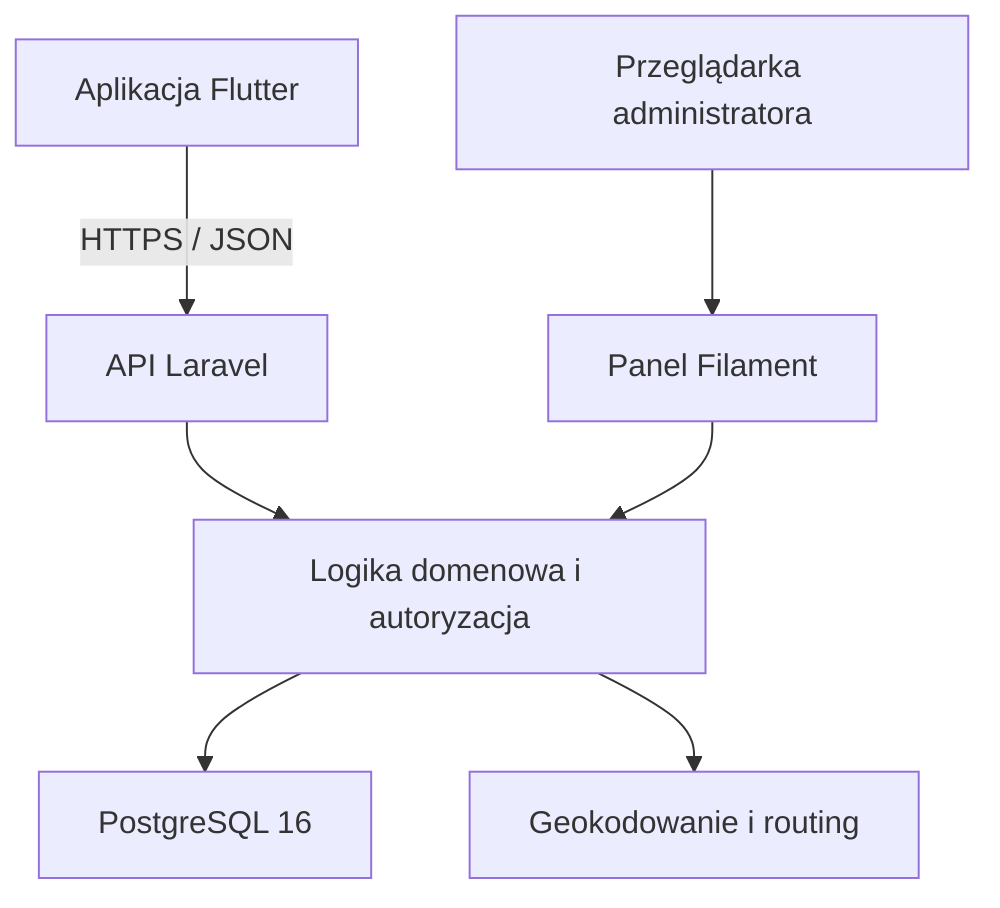

# MilesAway, dziennik podróży
**Projekt aplikacji turystycznej będącej osobistym dziennikiem podróży. Docelowo użytkownik będzie dokumentować odbyte podróże, oglądać je na interaktywnej mapie i przeglądać statystyki z całej historii lub wybranego roku.**

MilesAway to projekt aplikacji turystycznej umożliwiającej dokumentowanie odbytych podróży, prezentowanie tras na interaktywnej mapie oraz przeglądanie statystyk podróżniczych.

Celem aplikacji jest stworzenie miejsca, w którym użytkownik może zobaczyć, gdzie był, jakie państwa odwiedził i jakimi środkami transportu podróżował na przestrzeni lat.

System obejmuje:

- aplikację mobilną napisaną we Flutterze,
- API przygotowane w Laravel,
- webowy panel administracyjny oparty na Filament,
- bazę danych PostgreSQL.

## Cel projektu

MilesAway ma pełnić funkcję osobistego dziennika podróży.

Użytkownik powinien mieć możliwość zapisania podróży składającej się z wielu miejsc i odcinków, określenia transportu dla każdego odcinka oraz późniejszego przeglądania swojej historii na mapie.

Najważniejszym rezultatem projektu jest działająca aplikacja z czytelnym interfejsem, wiarygodną prezentacją tras i statystykami obejmującymi wiele lat podróżowania.

Projekt API i panelu administracyjnego jest powiązany z aplikacją realizowaną w ramach przedmiotu **Programowanie urządzeń mobilnych**.

## Funkcjonalności
### Konta użytkowników

- Rejestracja, logowanie i wylogowywanie.
- Edycja podstawowych danych profilu.
- Ustawianie profilu jako publiczny lub prywatny.
- Przeglądanie podróży innych użytkowników, jeśli ich profile są publiczne.
- Kontrola dostępu do danych po stronie API.

### Zarządzanie podróżami

- Dodawanie, przeglądanie, edytowanie i usuwanie podróży.
- Zapisywanie nazwy, daty lub zakresu dat oraz opcjonalnego opisu.
- Dodawanie wielu punktów do jednej podróży.
- Określanie kolejności odwiedzanych miejsc.
- Wybieranie środka transportu osobno dla każdego odcinka.
- Obsługa powrotów do wcześniej odwiedzonych miejsc.

### Interaktywna mapa

- Wyświetlanie pojedynczej podróży wraz z punktami i odcinkami.
- Wyświetlanie wszystkich podróży użytkownika na jednej mapie.
- Rozróżnianie transportu za pomocą kolorów, ikon lub stylów linii.
- Przybliżanie mapy i przeglądanie szczegółów tras.
- Automatyczne rozpoznawanie odwiedzonych państw na podstawie zapisanych podróży.
- Wyróżnianie odwiedzonych państw z wykorzystaniem danych ich granic.

### Statystyki podróżnicze

Statystyki obejmują **całą historię podróży** lub **wybrany rok kalendarzowy**:

- liczbę odbytych podróży,
- liczbę i listę odwiedzonych państw,
- liczbę odwiedzonych miejsc,
- łączny przebyty dystans,
- dystans pokonany poszczególnymi środkami transportu.

Szczegółowe zasady obliczeń, w tym sposób uwzględniania podróży na przełomie roku i powtarzających się miejsc, wymagają wspólnego zatwierdzenia przez zespół.

### Panel administracyjny

Webowy panel Filament służy do zarządzania danymi aplikacji.

Proponowany zakres obejmuje:

- logowanie administratora,
- przeglądanie i wyszukiwanie użytkowników,
- zarządzanie dozwolonymi danymi użytkowników,
- przeglądanie i zarządzanie podróżami,
- kontrolę dostępu do operacji administracyjnych.

Szczegółowe uprawnienia administratora, w tym dostęp do prywatnych podróży, wymagają zatwierdzenia. Zwykłe konto użytkownika nie przyznaje dostępu do panelu.

## Środki transportu

| Środek transportu | Sposób prezentacji |
| --- | --- |
| Samochód | Trasa wyznaczana po rzeczywistej sieci dróg. |
| Samolot | Bezpośrednie połączenie między punktami przedstawione na mapie jako łuk. |
| Pociąg | Połączenie przedstawione linią prostą. |
| Inne | Uproszczone połączenie między punktami. |

Transport jest przypisywany do **odcinka**, a nie do całej podróży.

Dystans samochodowy powinien pochodzić z silnika wyznaczania tras. Dla pozostałych środków transportu proponowane jest obliczanie odległości geodezyjnej i oznaczanie jej jako przybliżonej.

Brak możliwości wyznaczenia trasy samochodowej powinien być jawnie komunikowany. Linia prosta nie może być przedstawiana jako poprawnie wyznaczona trasa drogowa.

## Przykładowa podróż

| Kolejność | Odcinek | Transport |
| --- | --- | --- |
| 1 | Legnica → Berlin | Samochód |
| 2 | Berlin → Majorka | Samolot |
| 3 | Zwiedzanie Majorki — kilka punktów | Samochód |
| 4 | Majorka → Berlin | Samolot |
| 5 | Berlin → Legnica | Samochód |

Każdy odcinek zachowuje własny środek transportu, geometrię i dystans.

## Stack technologiczny

| Obszar | Technologia | Status |
| --- | --- | --- |
| Backend | PHP 8.3+, Laravel 12 | Wybrane |
| Uwierzytelnianie API | Laravel Sanctum | Wybrane |
| Panel administracyjny | Laravel Filament | Wybrane; wersja do ustalenia |
| Aplikacja mobilna | Flutter + Dart | Wybrane |
| Środowisko mobilne | Android Studio | Wybrane |
| Baza danych | PostgreSQL 16 | Wybrane |
| Konteneryzacja | Docker, Docker Compose | Wybrane |
| Mapa mobilna | Pakiet mapowy kompatybilny z Flutterem | Do ustalenia |
| Wyznaczanie tras | OpenRouteService lub OSRM | Do ustalenia |
| Geokodowanie | Nominatim, Photon lub inny dostawca | Do ustalenia |
| Granice państw | GeoJSON, np. Natural Earth | Zbiór i wersja do ustalenia |
| Testy backendu | PHPUnit | Wybrane |
| Testy mobilne | `flutter_test`, `integration_test` | Propozycja |
| Formatowanie PHP | Laravel Pint | Wybrane |
| Jakość kodu Dart | `dart format`, `flutter analyze` | Propozycja |
| CI/CD | GitHub Actions | Wybrane narzędzie; workflow do przygotowania |

## Architektura



backend/    # Laravel: REST API
mobile/     # Aplikacja mobilna Flutter
docker/     # Konfiguracja środowiska kontenerowego (Nginx, PHP, Node)
docs/       # Dokumentacja projektu

### Aplikacja mobilna

Odpowiada za interfejs użytkownika, formularze, prezentację map i statystyk oraz komunikację z API.

### API Laravel

Odpowiada za:

- uwierzytelnianie i autoryzację,
- walidację danych,
- zarządzanie profilami i podróżami,
- egzekwowanie prywatności,
- integrację z usługami zewnętrznymi,
- obliczanie statystyk.

Proponowany mechanizm uwierzytelniania aplikacji mobilnej to tokeny Laravel Sanctum.

### Panel Filament

Zapewnia webowy interfejs administracyjny. Powinien korzystać ze wspólnych reguł domenowych, aby zmiany administracyjne poprawnie aktualizowały trasy i statystyki.

Proponowany mechanizm logowania do panelu to sesja webowa.

### PostgreSQL

Przechowuje dane użytkowników, podróży, punktów, odcinków oraz informacje potrzebne do prezentowania map i statystyk.

## Interfejs użytkownika

Kierunek wizualny MilesAway to nowoczesny flat design z prostymi ilustracjami i warstwowym krajobrazem **paper cut-out**.

Założenia stylistyczne:

- ciepła paleta beżu, brązu, złota i leśnej zieleni,
- zaokrąglone karty,
- subtelne cienie,
- delikatna faktura,
- czytelne formularze i prosta nawigacja.

Planowane ekrany:

- logowanie i rejestracja,
- ekran główny,
- lista podróży,
- dodawanie i edycja podróży,
- szczegóły podróży z mapą,
- mapa wszystkich podróży,
- statystyki,
- profil i ustawienia prywatności,
- przeglądanie publicznych profili i ich podróży.

## Uruchomienie projektu

### Konfiguracja i sekrety

Nie należy umieszczać w repozytorium:

- plików `.env` zawierających dane dostępowe,
- haseł i tokenów,
- prywatnych kluczy usług zewnętrznych,
- rzeczywistych danych użytkowników,
- kopii produkcyjnej bazy danych.

Plik `.env.example` powinien zawierać nazwy wymaganych zmiennych i bezpieczne wartości przykładowe.

## Testy i jakość kodu

Poniższe polecenia są przewidziane do użycia po utworzeniu projektów i instalacji zależności.

### Backend

Uruchamiane z katalogu aplikacji Laravel lub we właściwym kontenerze:

```bash
php artisan test
./vendor/bin/pint --test
```

### Aplikacja mobilna

Uruchamiane z katalogu projektu Flutter:

```bash
dart format --output=none --set-exit-if-changed .
flutter analyze
flutter test
```

Testy integracyjne wymagają osobno skonfigurowanego emulatora lub urządzenia.

Najważniejsze obszary weryfikacji:

- rejestracja, logowanie i unieważnianie tokenów,
- dostęp do danych prywatnych i cudzych zasobów,
- poprawność punktów, kolejności i odcinków,
- prezentacja różnych środków transportu,
- błędy zewnętrznych usług,
- statystyki roczne i całej historii,
- przeliczanie danych po edycji i usunięciu podróży.

GitHub Actions ma automatyzować kontrole jakości i testy. Automatyczne wdrażanie wymaga wcześniejszego ustalenia środowiska docelowego.

## Organizacja pracy

Praca jest planowana i śledzona w **GitHub Issues**.

Każde zadanie powinno zawierać:

- cel i zakres,
- kryteria akceptacji,
- sposób weryfikacji,
- zależności,
- przypisaną osobę,
- priorytet i milestone.

Zmiany są przygotowywane na osobnych gałęziach i scalane przez pull request po przeglądzie kodu.

Szczegółowe zasady opisano w [CONTRIBUTING.md](CONTRIBUTING.md).

### Wymagania organizacyjne zajęć

- Projekt jest wykonywany w tych samych grupach co projekt z Programowania urządzeń mobilnych.
- Skład grupy i linki do publicznych repozytoriów należy zgłosić najpóźniej do drugich zajęć projektowych.
- Zgodnie z przekazanymi zasadami spóźnione zgłoszenie skutkuje modyfikatorem −0,5 do oceny końcowej projektu.
- Lista zadań obejmująca wymagania funkcjonalne i przypisane osoby powinna być gotowa przed czwartymi zajęciami.

Dokładne daty należy ustalić na podstawie harmonogramu grupy.

## Dokumentacja

Dokumentacja przygotowana w pakiecie projektu:

- [Zasady współpracy](CONTRIBUTING.md)
- [Backlog GitHub Issues](docs/ISSUES.md)
- [Decyzje i reguły biznesowe](docs/DECISIONS.md)
- [Dokumentacja API](docs/API.md)
- [Scenariusze odbioru](docs/ACCEPTANCE.md)
- [Źródła i podstawa opracowania](docs/SOURCES.md)

Zmiany API, konfiguracji i reguł biznesowych powinny być dokumentowane w tym samym pull requeście co implementacja.

## Zakres i ograniczenia

Projekt nie zakłada:

- nawigacji GPS,
- śledzenia lokalizacji w czasie rzeczywistym,
- idealnego odtwarzania faktycznie przebytej drogi,
- wyznaczania tras kolejowych po torach.

Trasy mają być wiarygodne i zgodne z wybranym środkiem transportu.

Zdjęcia, osobne wpisy wspomnień, obserwowanie użytkowników, polubienia, powiadomienia i planowanie przyszłych wyjazdów mogą zostać dodane jako rozszerzenia po realizacji podstawowych wymagań.

## Zespół

| Osoba | Konto GitHub | Odpowiedzialność |
| --- | --- | --- |
| Amadeusz Żyła | [@Amadeuszzyla](https://github.com/Amadeuszzyla) | Aplikacja mobilna, dokumentacja, konfiguracja i utrzymanie serwera VPS |
| Adrian Jurak | [@AdrianJurak](https://github.com/AdrianJurak) | Backend i API |
| Kyril Ryab | [@KirilRyab](https://github.com/KirilRyab) | Aplikacja mobilna |

## Licencja
Wykorzystane biblioteki, dane geograficzne i usługi zewnętrzne podlegają własnym licencjom oraz warunkom użytkowania. W aplikacji należy zachować wymagane informacje o autorstwie i źródłach danych.
Współpraca
Zasady współpracy opisuje CONTRIBUTING.md, procedura realizacji zadań jest w TASK_ins.md, a backlog w TASK.md.

Licencja
Projekt udostępniany na licencji MIT. Szczegóły w pliku LICENSE.
